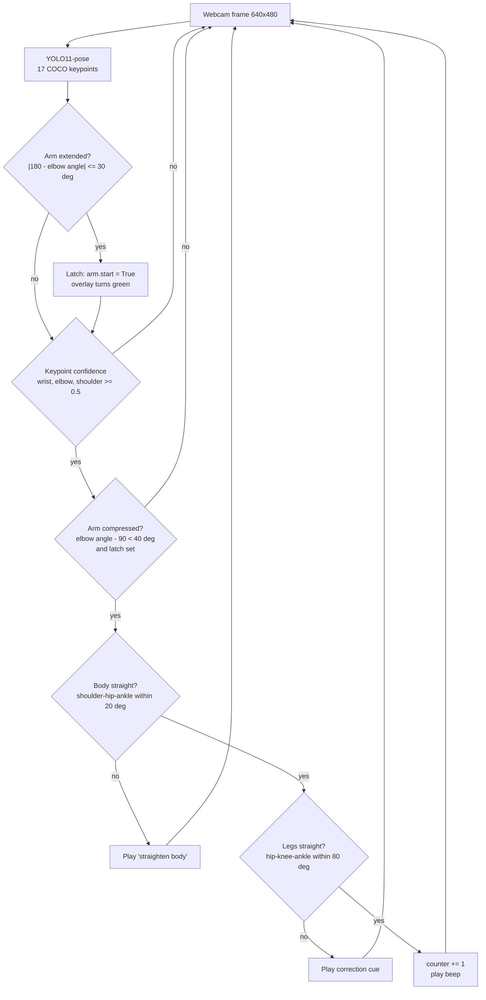
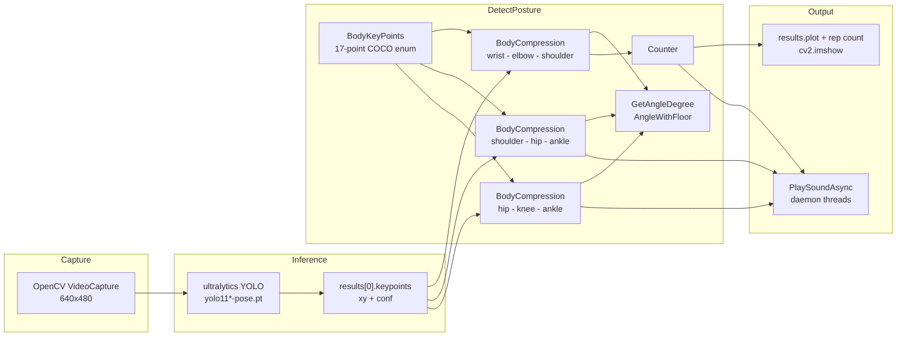

<div align="center">

# ELISS Push-Up Counter

**A form-aware push-up counter inspired by Singapore's ELISS test station: YOLO11 pose estimation, joint-angle geometry, and a rep gate that refuses to count unless your arms, body *and* legs all pass at the same instant — with spoken corrections when they don't.**


### Demo — turn sound on

https://github.com/user-attachments/assets/98ad50d7-28ff-4856-a285-697db160502b

<sub>Live webcam, YOLO11 pose overlay, rep count top-left. The audio cues in the clip are the real ones the program plays when a form check fails.</sub>

</div>

---

## At a glance

- **A rep only counts when four conditions hold in the same frame** — keypoint confidence, arm compression, body straightness and leg straightness. Fail any one and you get a spoken correction instead of a number.
- **Three joint chains, one geometry routine.** Arm, torso and leg are the same `BodyCompression` class instantiated over different COCO keypoint triples, so adding a check is three lines, not a new algorithm.
- **Audio feedback never blocks the video loop** — each cue is dispatched to a daemon thread and re-triggered only once the previous one has finished playing.
- **A latch, not a threshold.** The arm chain must first be seen *extended* before a compression can count, which is what stops a single slow descent registering as a dozen reps.
- **206 lines of Python**, no framework, no training — the model is off-the-shelf YOLO11-pose; everything that makes it a coach is the biomechanics logic.

---

## How a rep is judged

Every frame runs the full pose model and then walks a decision chain. The order matters: the cheapest, most specific check gates the expensive ones.



The angle itself is plain vector geometry — two normalised limb vectors, a clamped dot product, `arccos` in degrees (`GetAngleDegree`). Clamping before `arccos` is what keeps floating-point drift from producing a `NaN` angle on a perfectly straight limb.

---

## Architecture



### Repository layout

| Path | Contents |
| --- | --- |
| `main.py` | Capture loop, the three joint chains, the rep decision chain, overlay |
| `DetectPosture.py` | `BodyKeyPoints` enum, `BodyCompression` (angle, straightness, compression, confidence), `Counter`, `PlaySoundAsync`, `AngleWithFloor` |
| `Resource/Models/` | `yolo11n-pose.pt`, `yolo11n.pt` |
| `Resource/Sound/` | `beep.mp3` (rep counted), `straigthenbody.mp3` (form correction) |
| `Resource/` | `pushup.mp4`, `PushUpCut.mp4` sample footage |

### The thresholds, in one place

| Check | Call | Threshold |
| --- | --- | --- |
| Arm extended (latch) | `rightArm.CheckStraightness(results, 30)` | elbow angle within 30&deg; of straight |
| Keypoint confidence | `rightArm.TestCofidence(results)` | &ge; 0.5 on all three points |
| Arm compressed | `rightArm.TestCompression(results, 40)` | `angle - 90 < 40` with the latch set |
| Body straight | `body.CheckStraightness(results)` | shoulder-hip-ankle within 20&deg; (default) |
| Legs straight | `leg.CheckStraightness(results, 80)` | hip-knee-ankle within 80&deg; |

---

## Getting started

### Requirements

- Python 3.10
- A webcam

```bash
pip install ultralytics opencv-python numpy playsound3
```

### Run

```bash
python main.py
```

Position yourself side-on to the camera so the **right** shoulder, elbow, wrist, hip, knee and ankle are all visible. The rep count is drawn top-left; the overlay text turns green while the arm is extended and red otherwise. Press `q` to quit.

> `main.py` requests `Resource/Models/yolo11s-pose.pt`. The repository ships the smaller `yolo11n-pose.pt`, so ultralytics downloads the `s` weights on first run — point the path at the bundled `n` model to stay offline.

---

## Known limitations

These are the honest edges of the current build, and most of them are one evening's work each:

- **Right side only.** All three chains use the right-hand keypoints, so facing the wrong way breaks every check.
- **One person.** Only `keypoints[0]` is read; a second body in frame is ignored rather than rejected.
- **No temporal smoothing.** Angles are judged per frame, so a single noisy pose estimate can drop a rep or fire a cue. A moving average over the last few frames is the first fix.
- **Thresholds are hard-coded constants**, tuned by eye on one camera and one body. There is no calibration step.
- **The floor-angle check is written but disabled.** `AngleWithFloor` works and is called nowhere — the commented-out block in `main.py` would reject reps performed at the wrong body inclination.
- **The leg tolerance is 80&deg;**, which is generous enough that bent knees can still pass.
- **No tests.** Nothing verifies the geometry against known-angle fixtures, which is exactly what `GetAngleDegree` and `CheckStraightness` invite.

---

## Roadmap

- [ ] Moving-average smoothing over joint angles
- [ ] Unit tests for the angle maths against synthetic keypoints
- [ ] Left/right side auto-detection from keypoint confidence
- [ ] Re-enable the floor-angle gate
- [ ] Per-user calibration instead of fixed thresholds
- [ ] Multi-exercise support (sit-ups, pull-ups) over the same `BodyCompression` primitive
- [ ] Spoken coaching prompts and an on-screen form dashboard
- [ ] Mobile / edge deployment

---

Inspired by Singapore's ELISS push-up station. Pose model: [Ultralytics YOLO11](https://github.com/ultralytics/ultralytics).
